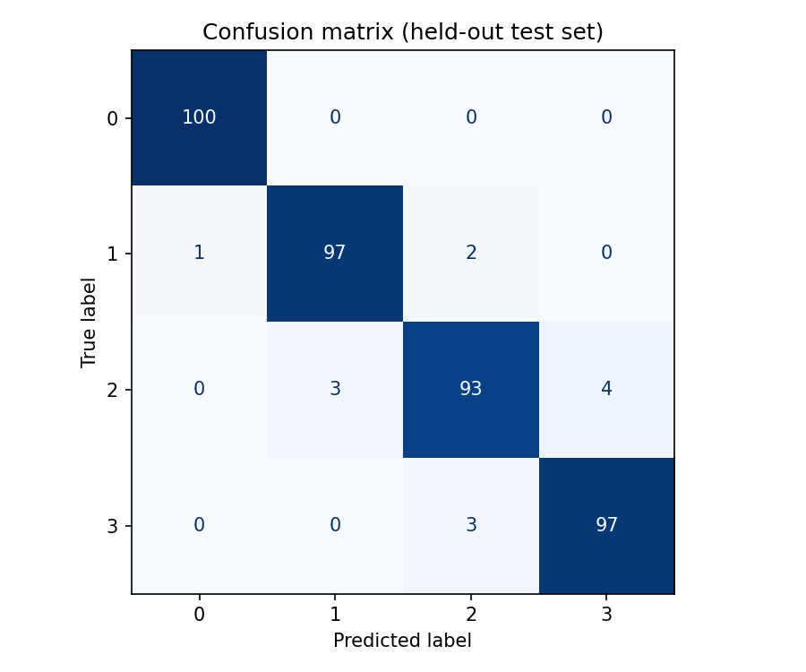
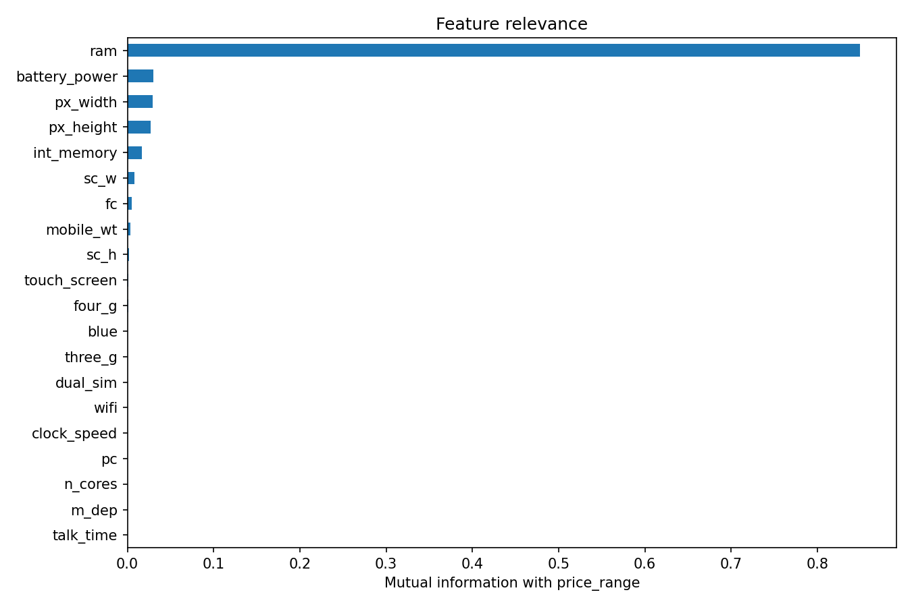
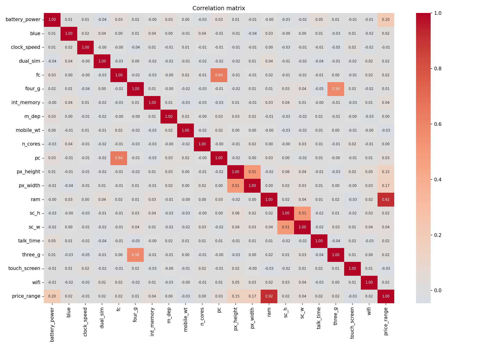

# Mobile Price Range Classification

Classifies mobile phones into one of **4 price ranges** (0 = lowest, 3 = highest) from their specifications, using logistic regression.



## Dataset

| File                | Rows  | Description                                        |
|---------------------|-------|----------------------------------------------------|
| `data/train.csv`    | 2,000 | 20 phone specs + target `price_range` (classes balanced, 500 each) |
| `data/test.csv`     | 1,000 | Same specs plus an `id` column, **no labels**       |

Main features: `ram`, `battery_power`, `px_height`, `px_width`, `int_memory`, `fc`, `pc`, `talk_time`, `n_cores`, and binary flags (`blue`, `dual_sim`, `four_g`, `three_g`, `touch_screen`, `wifi`).
There are no missing values in the training set.

## Project structure

```
mobile_classifiaction/
├── data/
│   ├── train.csv
│   └── test.csv
├── images/                    # plots generated by the script
├── notebooks/
│   └── exploration.ipynb      # original exploratory notebook
├── predictions/
│   └── test_predictions.csv   # predicted price_range for data/test.csv
├── src/
│   └── model.py               # reproducible training script
├── requirements.txt
└── README.md
```

## Getting started

```bash
git clone https://github.com/isof0001/mobile_classifiaction.git
cd mobile_classifiaction

python -m venv .venv
source .venv/bin/activate        # Windows: .venv\Scripts\activate
pip install -r requirements.txt

python src/model.py
```

### Options

| Flag             | Default            | Description                                   |
|------------------|--------------------|-----------------------------------------------|
| `--train`        | `data/train.csv`   | Labeled training data                         |
| `--test`         | `data/test.csv`    | Unlabeled data to predict                     |
| `--test-size`    | `0.2`              | Fraction of training data held out            |
| `--seed`         | `42`               | Random seed                                   |
| `--all-features` | off                | Use all 20 features instead of the 4 selected |
| `--show`         | off                | Display plots in a window                     |

## Method

1. **Exploration** – missing values check, correlation matrix, mutual information with the target.
2. **Feature selection** – `ram` dominates (MI ≈ 0.85); the next ones are `battery_power`, `px_width` and `px_height` (≈ 0.03 each). An extra `px_area` feature (height × width) did not beat the raw pixel dimensions, so it was dropped.
3. **Model** – stratified 80/20 split, then a `StandardScaler` + `LogisticRegression` pipeline on the 4 selected features.
4. **Evaluation** – 5-fold cross-validated AUC on the training part, then accuracy, AUC and a classification report on the held-out 20%.
5. **Prediction** – the model is re-fitted on all 2,000 labeled rows and used to predict `data/test.csv`.



## Results

| Features                      | CV AUC (mean) | Test accuracy | Test AUC |
|-------------------------------|---------------|---------------|----------|
| 4 selected (default)          | 0.998         | 0.968         | 0.999    |
| All 20 (`--all-features`)     | 0.997         | 0.965         | 0.999    |

Most errors are between neighbouring classes (e.g. 1 vs 2), which is expected for ordered price bands. The 4-feature model is as good as the full one, so the other 16 features add little.



## Ideas for next steps

- Try tree-based models (Random Forest, Gradient Boosting) and compare
- Treat the target as ordinal rather than 4 independent classes
- Tune the regularisation strength `C` with grid search
